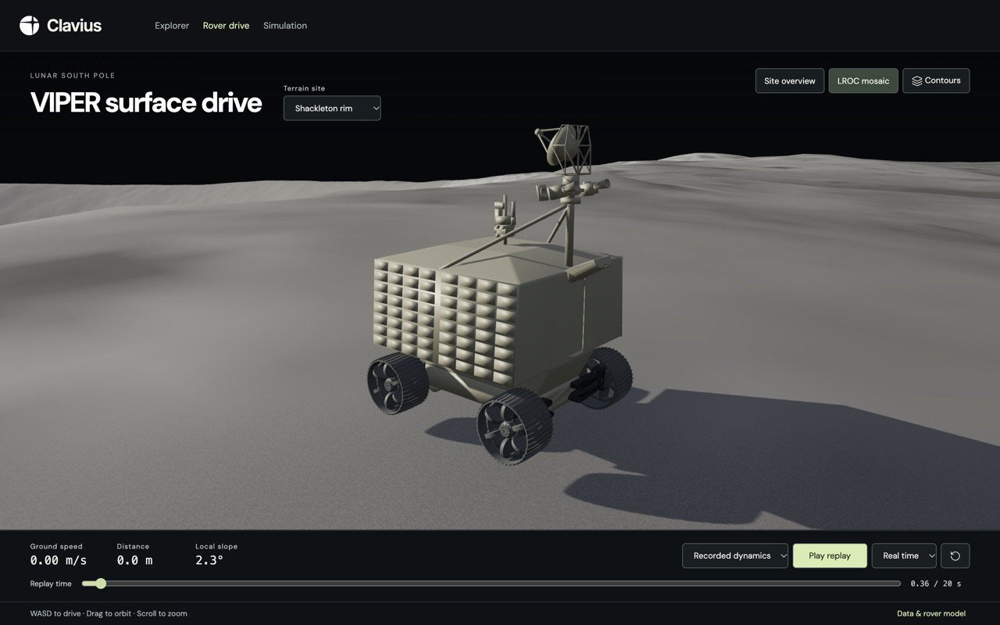

# Clavius

Explore the Moon from orbit, drive a 3D VIPER reference at two south-polar sites, and test mission scenarios on NASA terrain. The browser includes a manual drive and recorded Project Chrono straight and crab traverses at both sites.



## Run locally

Requires Node.js 20.19+ or 22.12+.

```bash
npm install
npm run dev
```

Open the Local URL printed by Vite (normally http://127.0.0.1:5173). The landing page is `/`; the explorer is `/app`. The NASA assets are included locally, so no API key is needed. The initial explorer load transfers approximately 57 MB of elevation, imagery and derived surface normals.

```bash
npm test
npm run build
npm run preview
```

The normal-derivation checks additionally require NumPy and Pillow:

```bash
python3 -m unittest discover -s tests -p 'test_*.py'
```

## Current interactions

- Landing page: animated distant rockets over a generated twilight sky, a white Inter “Mission Planning from Earth to the Moon” headline, and a Get started button linking to `/app`. The supplied brandmark and Inter wordmark appear in full-width navigation that gathers into a floating pill and stays visible at the top throughout the page. A visual rover, route and replay walkthrough introduces the simulator. The dataset section identifies the active sources, and the benchmark section reserves space for future validation results. See [the content map](docs/LANDING_CONTENT.md).
- Landing animation respects reduced motion and pauses when the sky is offscreen or the browser tab is hidden. The sky and rockets are decorative artwork, separate from NASA data. See [landing design notes](docs/LANDING_DESIGN.md) for the reference lock and image prompt.
- Rotate and zoom the globe with mouse or touch; use arrow keys with the viewport focused.
- Search/filter eight curated regions, or click a location on the Moon to pin it.
- Open a region's 400 km terrain patch; drag to orbit, right-drag to pan, or use WASD / arrow keys with the viewport focused. Navigation stays inside the available patch.
- View elevation-derived surface shading and regional terrain shadows; adjust the illustrative sun angle to reveal crater rims and slopes.
- Switch among LROC imagery, shaded relief and wireframe. Toggle the globe coordinate grid and adjust vertical exaggeration from 1× to 5×.
- Read latitude, longitude and interpolated elevation. Share the URL to retain the selected region or pin and view mode.
- Open Data & sources for resolution, processing and limits.

The globe and local patch are custom Three.js meshes, not an embedded Moon viewer. The global mesh samples the NASA DEM at its own vertex spacing. Terrain mode samples that same global DEM more densely; interpolation does not create additional measured detail.

The permanent dataset record is [NASA_DATASETS.md](docs/NASA_DATASETS.md). Future source changes must update that document and the asset manifest.

## NASA data and limits

Assets come from [NASA SVS CGI Moon Kit](https://svs.gsfc.nasa.gov/4720/), using the 2019 maps. Credit: NASA’s Scientific Visualization Studio, Ernie Wright, and the LRO / LOLA / LROC instrument teams.

- LOLA `ldem_16_uint.tif`: 5,760 × 2,880, 16 pixels/degree; approximately 1.9 km sample spacing at the equator. Preserved as little-endian unsigned 16-bit samples. Elevation is `sample × 0.5 − 10000` meters relative to a 1,737.4 km reference sphere. Pixel centers are sampled with bilinear interpolation, wrapping longitude and clamping at polar edges.
- The explorer uses 8,192 × 4,096 LROC imagery and streams the regional 64 px/degree LOLA grid on demand.
- Thumbnail and fallback LROC `lroc_color_poles_4k.tif`: 4,096 × 2,048, converted to a high-quality RGB JPEG. Polar regions beyond ±70° contain NASA's LOLA albedo fill; the mosaic includes inpainting and color adjustment for visualization.
- `lola-normals.png`: per-pixel surface normals derived from the same LOLA DEM; these improve shading without adding measured resolution. Reproduce with `python3 scripts/derive_lunar_normals.py`.
- Source URLs, source hashes, output elevation hash, dimensions and transformation details are recorded in [the asset manifest](public/data/manifest.json). To reproduce outputs, download the two original TIFFs from the manifest and run `python3 scripts/prepare_lunar_assets.py <elevation.tif> <color.tif>` with Pillow and NumPy installed.
- Curated site coordinates are approximate navigation targets, not surveyed landing locations.

The global explorer is a visualization foundation and does **not** resolve wheel-scale terrain or hazards. Its lighting is illustrative. The separate `/app/simulation` workspace below ingests measured 5 m Connecting Ridge and Shackleton rim terrain, computes date-specific geometry, and runs mission assessments and rover dynamics.

## Existing planning handoff

The earlier planning documents and proposed integration contracts remain in place. Start with [the partner handoff](docs/planner-handoff/HANDOFF.md), then:

- [Datasets and APIs](docs/planner-handoff/DATA_SOURCES.md)
- [Integration agreement](docs/planner-handoff/INTEGRATION.md)
- [Build tasks and acceptance checks](docs/planner-handoff/BUILD_TASKS.md)
- [JSON Schemas](contracts/v0.1/)
- [Synthetic example messages](examples/integration/)

Validate the handoff examples separately:

```bash
uv run --with 'jsonschema[format]' python scripts/validate_handoff_contracts.py
```

Earth departure screening is in the planning scope, with a declared parking-orbit transfer family and lunar encounter/capture. It is not implemented in this explorer.

## Robot simulation workspace

Open `/app/simulation` (or select **Simulation** from the explorer). The source-grounded setup follows the import inspection pattern in [Isaac Sim](https://docs.isaacsim.omniverse.nvidia.com/6.2.0/importer_exporter/ext_isaacsim_asset_importer_urdf.html), activities/resource modeling in [NASA Aerie](https://superintelligence.jpl.nasa.gov/public/projects/aerie/), and shared-time playback in [Foxglove](https://docs.foxglove.dev/docs/visualization/playback).

```bash
uv venv .venv
uv pip install --python .venv/bin/python -r requirements-simulation.txt
.venv/bin/python scripts/setup_simulation.py
npm run dev:simulation
```

The launcher reuses existing local services or starts the FastAPI backend at 127.0.0.1:8001 and Vite at 127.0.0.1:5173. API calls pass through Vite's `/api` proxy. Restart an older Vite process after adding the proxy configuration. Raw NASA files total about 270 MB; they are hash-verified and downloaded once. The environment and raw cache are ignored, with sources pinned in `public/data/simulation-manifest.json`.

Current implementation includes data-only URDF/ZIP import, physical inspection, a hypothetical primitive-collider reference rover, versioned mechanical properties and capability profiles, a measured terrain viewport with a Connecting Ridge / Shackleton rim site picker with relief/slope/height-RMS layers, route/activity setup, UTC/elapsed mission clocks, native SPICE geometry, sampled terrain horizons, finite-disk solar visibility, battery/constraint evaluation, native MuJoCo detailed rover segments, saved runs, replay, comparisons, bounded sensitivity sweeps and evidence ZIP exports. Import schemas retain the v0.1 robot capability contract; run/package envelopes use v0.2.0.

The mission model uses declared speeds and power, with extra uphill gravitational work and separately accounted heater/science/radio loads. Its energy ledger owns battery state. Detailed segments launch from a selected saved mission cursor with the same robot, ENU position, heading and UTC origin. Choose **MuJoCo** on the Mac or **Gazebo / ROS 2** in the local Linux VM. Both execute physical rigid-contact dynamics; their separate energy record does not overwrite mission energy. Gazebo Harmonic 8.15.0, DART and ROS 2 Jazzy now run in a local Colima ARM64 VM, with native gravity/driving benchmarks, a measured-terrain probe and cancellation verified on 15 November 2026. Gazebo contact force/count channels remain uninstrumented and null. The app keeps this engine disabled unless its recorded runtime passes the benchmark. Read [the local worker instructions](workers/gazebo/README.md) and [implementation evidence](docs/SIMULATION_IMPLEMENTATION.md) for the scope and remaining scientific limits.

The local tools are installed on this Mac. Start or resume its worker, then launch the app:

```bash
npm run gazebo:start
npm run dev:simulation
```

Run `npm run gazebo:benchmark` on first setup or after a worker version change. `npm run gazebo:status` checks readiness; `npm run gazebo:stop` releases the VM's resources while retaining evidence. The app launcher reads the private, ignored local worker configuration. No separate Linux host is needed for this setup. The [native benchmark report](docs/validation/gazebo-native-benchmark.json) and [runtime record](docs/validation/gazebo-local-runtime.json) contain the actual executed evidence.

Local run state is stored in `data/runtime/clavius.sqlite3`, with content-hashed JSON artifacts and extracted robot assets under `data/runtime/`. The API is intended for local development. The 5 m terrain is not a wheel-scale hazard map; friction, soil/dust multipliers, motor efficiency and heater power are declared assumptions. Optional battery/enclosure thermal screening couples a uniform thermal node, thermostat and charging-temperature inhibition to the same mission energy ledger. Hardware properties and constant ground temperature are declared assumptions; measured or calibrated battery temperature and sinkage remain unresolved. Enable **Couple temperature and power** under **Battery temperature**, review **Properties**, and run a mission. **Inspect NASA temperature context** shows two historical Diviner summer/local-time composites, with gaps preserved. A covered value can seed a constant ground scenario; it is not a temperature forecast. Prepare this optional 410 MB source cache with `.venv/bin/python scripts/setup_simulation.py --diviner`; see [the dataset and model scope](docs/DIVINER_CONTEXT.md). The linked chart/events, comparison metrics and export retain those inputs. See [the model and validation](docs/THERMAL_MODEL.md). The earlier 0.0157° horizon check is historical. Dated LROC comparisons now cover two regional dates and one epoch at both local sites; they exposed missed ridges and led to corrected native/near-observer sampling. Some refinement targets remain unmet. The **Data & models** dialog links the evidence snapshot; see [observed illumination validation](docs/ILLUMINATION_VALIDATION.md). Optional original validation files can be prepared with `.venv/bin/python scripts/setup_simulation.py --observed-shadows`, followed by `npm run validate:illumination`. Wider scientific validation remains incomplete.

Use **Find bounded alternatives** in a saved mission's results to enumerate permitted date/wait/power scenarios. Required route/activities and hard limits stay fixed. The current model reruns the source request, ranks nominal candidates by an exposed cost, freezes candidates before independent audits, and recommends only an alternative supported by every selected audit case. Each nominal/audit mission is replayable. Completed search ZIPs reproduce candidate/audit outcomes; cancellation retains a downloadable checkpoint. These are bounded sensitivity checks, not real-world probabilities or a global optimizer. See [repair search scope](docs/REPAIR_SEARCH.md).

Validation commands:

```bash
npm run test:simulation
npm test
npm run build
```

The simulation tests check URDF properties and unsafe imports, exact charging/discharging, coordinate normalization, solar-disk geometry, SPICE unit vectors and clock conversion, real-site energy integration and reserve crossing, and physical rover contact/weight/driving on flat and measured terrain.

New evidence ZIPs contain the exact original robot upload, recorded numerical implementation, dependency pins, input/source identities and assessment. To rerun an exported mission or dynamics probe against the prepared NASA cache:

```bash
.venv/bin/python scripts/reproduce_simulation.py /path/to/evidence.zip
```

Use a trusted Clavius export, since reproduction executes its captured Python implementation. The command verifies code, assessment and robot checksums and compares metrics with relative/absolute tolerance 1e-6. Scenario sweeps include full child assessments; open a child replay and export it to reproduce that scenario. Historical development runs without source snapshots cannot be reproduced this way. See [the recorded date comparison](docs/validation/reference-comparison.json) and [implementation evidence](docs/SIMULATION_IMPLEMENTATION.md).

The two curated simulation sites each retain their own ENU origin, local height/RMS assets and Diviner clip. Saved replay restores its recorded site; mission-linked dynamics rejects a mismatched site. Site04 uses NASA’s published ROI record 4 as its analysis reference. [Source and registration details](docs/MULTISITE.md).

**Terrain uncertainty:** choose the nominal surface or a published NASA statistical clone (001–003) beside the site selector. Slopes, local horizons and rover contact use the selected full surface in a fixed nominal ENU frame. **Nominal LOLA support** shows return-count support separately from interpolated cells; click for the native count. Default sweeps test nominal/001 and repair audits use distinct 002/003 surfaces. Regional PGDA90 stays nominal. Only three of the 100 published members per site are loaded. See [terrain uncertainty and evidence](docs/TERRAIN_UNCERTAINTY.md).

The development watcher intentionally ignores scientific data directories. After adding new files under `public/data/`, restart `npm run dev` once so Vite refreshes its static-file catalogue. A failed support-image hash check disables that layer; it never substitutes the app HTML or a blended map for the pinned image.


## Robot accuracy and published mobility checks

The current priority is documented NASA robot models and stronger physical/environment validation. Broad schematic imports remain a future extension; the existing bounded URDF importer stays available. The current app reference rover is explicitly hypothetical. Official NASA/JPL visual assets are not silently assigned its mass, inertia or power properties.

A native single-wheel benchmark now compares published NASA Glenn TREC geometry/load/velocity conditions with 18 author-distributed traction plot points. It passes rig control and three fine-step checks but misses physical traction targets (12.83° RMS discrepancy). Open **Simulation → Data & models → Review wheel comparison & limits** for the plot, all points, source hashes and separate checks. This is evidence of the remaining rigid-soil modeling gap, not lunar calibration. See [the protocol and result](docs/MOBILITY_VALIDATION.md) and [NASA model source audit](docs/validation/nasa-robot-source-audit.json).

```sh
npm run test:mobility
npm run validate:mobility -- --output data/runtime/mobility/new-wheel-comparison
```

[Both original GMAT R2026a lunar examples](docs/GMAT_REFERENCES.md) also executed through the installed native Console/API with retained residual/event/endpoint evidence. A bounded transfer search and continuous clearance/tighter repropagation remain pending. Run `npm run test:orbital` or `npm run gmat:references -- --output data/runtime/gmat/new-reference-run` to exercise the separate orbital reference path.

### Drive VIPER

Run `npm ci` and `npm run dev`, then open **Rover drive** from the explorer or go directly to `/app/drive`. The rover, both south-polar sites, historical 1 m/pixel LROC imagery and native replays ship in the repository and run in a WebGL 2 browser. Hold WASD, the arrow keys or the on-screen controls to drive. **Site overview** shows the surrounding landscape. Select **Recorded dynamics** to replay a 20-second rigid-contact experiment and inspect the actual wheel and suspension motion. The separate mission assessment workspace uses the Python service.

To compare polar lighting, select **Recorded dynamics → Sun at rover → Mission sunlight**, pick a UTC start and scrub the replay. The three January 2028 starts work without the Python service. With the simulation service running, you can also select a custom date or sample sunlight along a manual drive. The readout gives the fraction of the solar disk above the local terrain horizon at the rover. The **Survey light** setting shows the historical LROC mosaic.

Select **Crab steering** in manual drive to move diagonally while keeping the chassis pointed in the same direction. Hold W with A or D. In **Recorded dynamics**, choose **25° crab traverse** and expand **Compare recorded paths** to see how far the rover traveled relative to the straight run at the same elapsed time.

With **Mission sunlight** selected, expand **Solar array estimate** to see gross watts from the port, starboard and aft arrays. Recorded dynamics also shows watt-hours generated through the replay cursor. In the 21 January 2028 straight run at Shackleton rim, the estimate is 0.632 Wh over 20 seconds. Connecting Ridge stays in terrain shadow for the same run and date. [Hardware sources and model limits](docs/NASA_ROBOT_MODELS.md#viper-solar-array-estimate)
