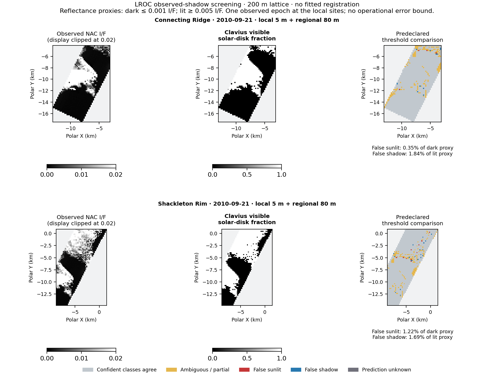

# Dated LROC illumination comparisons

Updated 15 November 2026. Clavius now has a reproducible observed-image screening pipeline. It does **not** establish an operational accuracy bound. The current evidence includes two regional dates and one observed epoch overlapping both curated rover sites. Some numerical targets remain unmet.

## Sources and selection

[NASA PGDA Product 90](https://pgda.gsfc.nasa.gov/products/90) supplies paired `M*E_20MPP.TIF` projected NAC images in **I/F** and `M*_20MPP_MODEL.TIF` published renderings in **W/m²**. The renderings are a separate model reference, never observational truth or directly comparable brightness. Citation: Barker et al. (2023), [10.3847/PSJ/acf3e1](https://doi.org/10.3847/PSJ/acf3e1). No 20 m DEM was downloaded or substituted for the simulation terrain.

The first two archive entries, M1188426614 and M1311409938, were selected before Clavius predictions. Neither overlaps the rover sites, and the latter requires rays outside the loaded regional grid. A fixed archive-order coverage rule selected M139729686 as the first additional scene with a complete center ray. All nine inspected catalog results and the excluded coverage outcomes remain in `validation/lroc-metadata/` and `observed-shadow-coverage-selection.json`. Short wildcard searches can return other image IDs; exact label-name matching is required.

Each camera uses the midpoint of its original PDS4 `Observation_Area/Time_Coordinates` start/stop fields, not a date decoded from its filename. The label's current Identification_Area version is retained independently of its modification history. The three scene midpoints are approximately **2015-06-08 18:16:14.587 UTC**, **2019-05-02 04:18:17.800 UTC** and **2010-09-21 17:34:01.211 UTC**. Each exposure spans about 53 seconds; endpoint visibility sensitivity is sampled, but individual pushbroom line times are not modeled.

Original URLs, bytes, SHA-256 hashes, numeric CRS, native affine transforms, nodata and tags for all nine TIFFs and six labels are in `public/data/simulation-manifest.json#observed_shadow_validation`. The machine-readable explorer manifest links the same source record and the published report. Original files remain in ignored `data/raw/lroc-validation/`; small archived catalog responses are tracked. These are validation inputs, not active rover imagery.

## Protocol and model correction

`validation/observed-shadow-protocol.json` records the staged protocol. The initial regional protocol/code/results and the subsequent pre-fix local results are preserved in two ZIP snapshots. The image thresholds, geographic selection and evaluation lattice were not fitted to agreement.

The projected camera grids have different origins. A common **200 m** lattice reads the containing native 20 m pixel without interpolation, with LE priority in overlap. Maximum observed pixel-center displacement is 10.583 m in these scenes. Numeric CRS parameters match the lunar south polar stereographic terrain CRS; no translation, rotation or timing fit is applied. Invalid GDAL pixels remain missing. Source registration accuracy is not independently established.

The primary reflectance proxies classify I/F ≤ 0.001 as dark and ≥ 0.005 as lit. Intermediate values remain ambiguous. Two frozen sensitivity pairs, 0.0005/0.0025 and 0.002/0.010, show substantial threshold dependence. Clavius fractions ≤ 0.05 are dark, ≥ 0.95 lit, with partial visibility separate. Albedo, incidence angle, scattering and radiometry can confound reflectance proxies; these are not NASA-annotated shadow labels.

The local comparison uncovered a production sampling defect: beyond 1 km, 80 m radial steps could skip narrow ridges inside the 5 m local surface. `terrain.horizon_distances` now retains at least native local posting across the padded projected diagonal of each curated patch, preserves the original regional/far lattice, and samples local interpolation at ≤ 0.625 m in the first km. A synthetic 10 m wide ridge at 1,040 m is now detected by the regression test. These finer numerical samples **do not add measured detail**. Sun/Earth directions still use geometric `NONE`, `MOON_ME_DE421`, the pinned kernels and lunar curvature; image checks use a surface observer at 0 m rather than a rover mast height.

## Recorded results after the correction

“False sunlit” below means predicted fraction ≥ 0.95 among confidently dark observed proxy samples; “false shadow” means predicted fraction ≤ 0.05 among confidently lit proxy samples. Unknown and ambiguous cases are retained separately. A small percentage alone does not validate the physical model.

| Scope / scene | Assessed samples | False sunlit | False shadow | Symmetric boundary p95 |
| --- | ---: | ---: | ---: | ---: |
| Regional 80 m / M1188426614 | 5,671 | 1 / 2,625 (0.038%) | 0 / 2,834 | 800 m |
| Regional 80 m / M139729686 | 10,102 | 108 / 3,814 (2.832%) | 3 / 5,297 (0.057%) | 721 m |
| Connecting Ridge 5 m + regional / M139729686 | 1,876 | 4 / 1,131 (0.354%) | 11 / 598 (1.839%) | 200 m |
| Shackleton rim 5 m + regional / M139729686 | 2,163 | 10 / 817 (1.224%) | 20 / 1,185 (1.688%) | 283 m |

**M1311409938 remains unassessed:** all 12,959 observed samples lack complete supported horizon rays. Its zeros in a confusion matrix are not success; rates are null. Regional and local rows are overlapping experiments, not independent samples to combine into an accuracy percentage.

Boundary distances use the 200 m lattice, an I/F midpoint threshold of 0.003 and visible fraction 0.5. Four-neighbor coverage is required so footprint/nodata edges cannot count as shadow edges. These are coarse boundary distances, not a claim of 20 m localization accuracy.

At every twentieth observed sample, 1×/2×/4×/8× radial refinement is recorded. The original numerical targets are Δhorizon ≤ 0.05° and Δvisible fraction ≤ 0.05. After the correction, local 1×→2× maximum horizon changes are **0.07924°** and **0.13045°**; five/eight tested local positions exceed the horizon target. Their maximum visible-fraction changes are 0 and 0.002687. Local 4×→8× maximum horizon changes are 0.01184° and 0.03186°. Regional 1×→2× still reaches 0.10812° / 0.07696 visible fraction. Thus the numerical gate is **not fully passed**, despite improved sampling and limited fine-level convergence. Wider dates, locations, clones, disk-edge structure and independently registered image truth remain necessary.



## Reproduction and app access

Prepare the normal scientific environment and sources first. The optional validation originals total about 153 MB; downloading preserves at least 256 MiB free. No missing source is replaced with synthetic terrain.

```sh
.venv/bin/python scripts/setup_simulation.py --observed-shadows
npm run validate:illumination
# Alternative output for a repeat, preserving the reviewed report:
npm run validate:illumination -- --output work/illumination-repeat/observed-shadow-comparison.json
python3 scripts/render_shadow_validation.py  # optional Matplotlib authoring dependency
.venv/bin/python scripts/publish_shadow_validation.py
npm run test:simulation
```

`observed-shadow-comparison.json` retains full confusion matrices, denominators, all refinement samples, acquisition spans, source versions, code hashes and software versions. Per-scene compressed NPZs retain I/F, NASA rendering, predicted fractions/horizons, masks, camera selection and projected coordinates. Figure hashes and their renderer are recorded separately. The publisher refuses changed implementations, protocol, source specification or sample files. Normal reruns do not silently replace the snapshot linked in **Data & models**.

The [independent rerun](validation/observed-shadow-reproduction.json) reproduced every numerical field and all 35 arrays exactly; all three NPZ files were byte-identical. Only measured elapsed wall time is excluded from report equality. The numerical suite passed 105 tests, with seven JavaScript terrain tests and a successful production build.

The live application and its local Gazebo worker use source `a0805fea622905276fa969f2044e918031697f5d9aa0990564fa2a73d01c8535`. The [updated native runtime record](validation/gazebo-horizon-runtime.json) retains the matching benchmark, image/native versions and preserved prior image tag. Mission `f141b35b-9481-4f10-8d2e-0c000a89407c` and linked native segment `599c416a-7587-4678-a2c8-5472bc12d66e` both completed. The 20-second segment traveled 1.09896 m with 201 received ROS 2 clock messages; contacts remain null. Their [mission](validation/horizon-mission-reproduction.json) and [Gazebo](validation/horizon-gazebo-reproduction.json) exports reproduced all metrics within 1e-6 with no differences. These are separate software/rigid-contact checks, not observed-lighting or regolith calibration.

[Browser acceptance](validation/observed-shadow-browser.json) verified saved mission/site/surface restoration, source-scope copy, a parsed JSON download matching the published SHA-256, and a 390 px dialog with no horizontal overflow and a reachable report link. The [acceptance record](validation/illumination-acceptance.json) keeps passed software checks distinct from the incomplete scientific validation gate.
